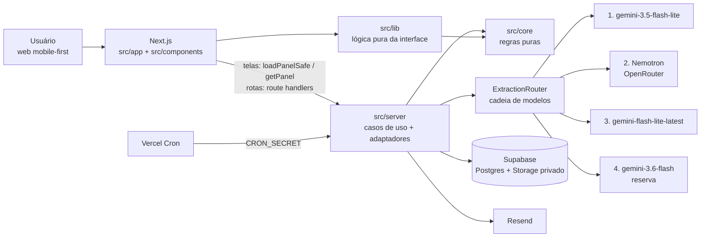
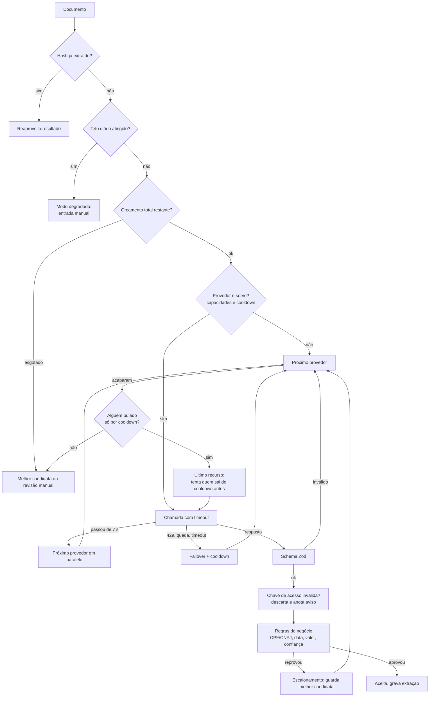

# Arquitetura do Teto

> **Princípio central: a IA propõe, o código dispõe.** O modelo só lê o documento.
> Toda regra de negócio (limites, risco, projeção, alertas, conciliação) é código
> determinístico, tipado e testado. O humano confirma antes de qualquer valor
> afetar o limite.

Documentos relacionados: [modelo de dados](DATA-MODEL.md) ·
[plano de execução](PLANO.md) · [regras do MEI](mei-rules.md) ·
[engenharia de IA](AI-ENGINEERING.md) · [auditoria](AUDITORIA.md) ·
[interface](INTERFACE.md) · [segurança](SEGURANCA.md) · [revisão](REVISAO.md)

Legenda de status: ✅ implementado · 🟡 projetado, a implementar · ❓ decisão em aberto.

## 1. Visão geral



O navegador **nunca** fala com o banco nem com os provedores de IA: tudo passa
pelo servidor. Chaves existem só no servidor.

## 2. Camadas e regra de dependência

| Camada | Pasta | Pode depender de | Não pode depender de |
|---|---|---|---|
| Núcleo de domínio | `src/core` | nada (nem Node, nem rede, nem relógio) | qualquer outra camada |
| Servidor | `src/server` | `core` | `app`, `components` |
| Lógica da interface | `src/lib` (textos, simulação, formatação, conciliação, geometria da barra, duplicidade) | `core` | `server`, banco, rede |
| Componentes | `src/components` | `lib`, `core`, e só tipos e validadores puros de `server` (`TransactionView`, `validateProfile`) | banco ou IA |
| Telas e rotas | `src/app` | `server` (as telas leem o painel por `loadPanelSafe`/`getPanel`; as rotas chamam os handlers de `src/server/http`), `lib`, `components` | acesso direto a banco ou IA |

O núcleo não importa nada fora de `src/core`. Hoje isso é conferido por revisão, **não** por uma regra
automática de lint. Todo efeito colateral (banco, rede, relógio, e-mail) entra por **portas** (interfaces) com
implementações trocáveis, o que permite testar o produto inteiro sem rede.

### Portas previstas

| Porta | Implementações | Status |
|---|---|---|
| `VisionProvider` | Gemini, OpenRouter, falsa (testes), gravação e replay (eval) | ✅ |
| `CooldownStore` | memória (testes), Postgres (produção) | ✅ |
| `Clock` | sistema em `America/Sao_Paulo`, fixo (testes) | ✅ |
| `Repositories` (perfil, transações, documentos…) | Supabase, memória (testes) | ✅ perfil, documentos, extrações, transações e storage |
| `EmailSender` (alertas) e `AlertsRepo` | Resend e Supabase, memória (testes) | ✅ |
| `QuotaGuard` | Postgres (contador diário), memória | ✅ |

## 3. Núcleo (`src/core`)

| Módulo | Responsabilidade | Status |
|---|---|---|
| `limits` | Limite anual, proporcional na abertura, receita acumulada | ✅ |
| `risk` | Faixas de risco e estimativa de custo do estouro | ✅ |
| `projection` | Projeção linear e datas de cruzamento do limite e da tolerância | ✅ |
| `scenario` | Simulador "e se eu aceitar uma venda de R$ X?" | ✅ |
| `alerts` | Alertas idempotentes | ✅ |
| `das` | Próximo vencimento do DAS | ✅ |
| `reconcile` | Cruzamento determinístico extrato × notas | ✅ |
| `documents` | CPF, CNPJ, chave de acesso e `deriveDirection` (receita ou despesa, decidido no código) | ✅ |
| `dashboard` | Resumo do painel: limite do ano, acumulado, faixa, custo estimado, projeção, DAS e alertas | ✅ |
| `monthly` | Receita por mês e por trimestre (gráfico do painel e relatório) | ✅ |
| `config` | Configuração **versionada por ano** (`rulesFor`, `RULES_BY_YEAR`: limite, tolerância, alíquotas) | ✅ |
| `dates` | Aritmética de datas ISO (sem relógio: "hoje" chega por parâmetro) | ✅ |

### Ajustes de fundação (Fase 0, implementados)

1. **Status da transação** no lugar de `confirmed: boolean`:
   `pendente | confirmada | cancelada`. Só `confirmada` entra no acumulado.
   Estorno, devolução e nota cancelada passam a ser `cancelada`, sem valor negativo.
2. **`Clock` em `America/Sao_Paulo`.** O núcleo continua recebendo `today` por
   parâmetro (puro); quem calcula "hoje" é a borda, no fuso de Brasília. Evita o
   erro de o dia virar às 21h locais por causa do UTC.
3. **Regras por ano.** `rulesFor(year)` devolve limite, tolerância e alíquotas
   daquele ano; 2026 é o padrão. A lei muda, o código não.
4. **Data que conta para o limite** isolada em um único campo (`date`) da
   transação. Qual critério alimenta esse campo (emissão ou recebimento) é uma
   decisão de negócio ❓ ver §13; o núcleo não precisa mudar quando ela for tomada.

## 4. Extração com IA (`src/server/extraction`)



Decisões de projeto:

- **Failover** trata falha técnica; **escalonamento** trata falha de qualidade.
- **Orçamento total (`totalBudgetMs`, 40 s)** além do timeout por chamada (25 s), para a cadeia
  nunca estourar o limite de tempo da função serverless. ✅
- **Segundo modelo em paralelo (hedging):** se o modelo em andamento passa de 7 s sem responder, o próximo da
  cadeia é disparado em paralelo; o primeiro a devolver uma extração aceita vence e cancela o outro, sem cooldown.
  Se o primeiro falha, o seguinte entra na hora. ✅
- **Cooldown por tipo de falha:** 60 s para limite de taxa e timeout, 90 s quando o provedor responde
  "alta demanda" (o Gemini devolve 503 com frequência; o 503 volta em ~2 s, então errar de novo custa pouco).
  Chave recusada ou sem crédito (401, 402, 403): 10 min. Se o provedor manda `Retry-After`, esse prazo prevalece
  (até 1 hora). ✅ (não há retentativa com backoff no mesmo provedor: a próxima tentativa é sempre o modelo seguinte)
- **Cota e cooldown consultados juntos:** a cota do dia é consumida ao mesmo tempo em que o cooldown de todos os
  provedores é lido, em vez de uma consulta por provedor, em fila. ✅
- **Último recurso:** se ninguém foi aceito, quem foi pulado só por estar em cooldown é tentado de novo, começando
  pelo que sai dele primeiro. O cooldown é uma estimativa: antes, quando todos entravam em cooldown, a extração
  desistia sem tentar ninguém, e o segundo modelo que poderia corrigir um dígito mal lido ficava de fora. ✅
- **Capacidades por adaptador** (`supportsPdf`, `maxBytes`, `maxPages`): o
  roteador pula quem não consegue processar aquele arquivo. ✅
- **Cooldown persistido** (`CooldownStore` no Postgres): em serverless, memória
  de instância não vale entre requisições. ✅ Se o banco do cooldown ou da cota falhar, o roteador
  segue sem eles (fail-open): uma falha de apoio não derruba a extração.
- **Cache e idempotência por hash** do conteúdo (`processUpload`): o mesmo arquivo nunca é lido
  duas vezes (poupa cota gratuita e sustenta a demo). Upload simultâneo do mesmo arquivo é resolvido
  pela restrição única do banco. ✅
- **Versão do prompt e do schema** gravada em cada extração (`extractions.prompt_version` e `schema_version`),
  para o resultado do `eval` apontar para o prompt que o gerou. Prompt atual: **v4**. ✅
- **Chave de acesso inválida é descartada**, não reprova (`sanitizeExtraction` em `validate.ts`). A chave só serve
  para reconhecer a mesma nota enviada duas vezes; não muda valor, data nem direção. Uma chave que não passa no
  dígito verificador vira `null`, a nota segue e o aviso (`ACCESS_KEY_DROPPED_NOTE`) vai no campo `issues` da
  resposta, que a conferência mostra como "A chave de acesso não pôde ser lida e foi ignorada". **CPF/CNPJ
  inválido continua reprovando**, porque decide receita ou despesa. ✅
- **Rastro persistido** (`extractions`): provedor, tentativas, latência, issues, versões do prompt e do schema. ✅
- **Leitura e gravação em paralelo** (`processUpload`): a busca por hash e a contagem da janela saem juntas; a IA
  começa a ler enquanto o arquivo vai para o storage e o registro para o banco. Se a gravação falha depois da
  leitura, a leitura (e a cota) se perde; é raro e preferível a deixar todo envio mais lento. O id do perfil fica
  em cache por 5 minutos (`CachedProfileIdRepo`). Medido da máquina local contra o Supabase em Oregon: o tempo
  fora da IA caiu de 2,0–3,8 s para 0,9–1,3 s. ✅
- **Contrato único** (`schema.ts`): dele saem o validador e o JSON Schema
  enviado aos provedores. ✅
- **Direção decidida no código.** A IA devolve as duas partes (`issuerTaxId`: quem vendeu ou
  recebeu; `recipientTaxId`: quem comprou ou pagou). Se o documento é receita ou despesa do MEI
  é decidido por `deriveDirection`, comparando com o CNPJ do perfil. A IA não decide isso. ✅
- **Limite por janela:** no máximo 30 documentos novos a cada 10 minutos (`429`), antes de gastar IA e
  storage. Reenvio do mesmo arquivo não conta. ✅
- **Foto reduzida no aparelho** (`src/lib/image-resize.ts`): fotos acima de 1,5 MB viram um JPEG de até ~3 MB
  antes de subir, sem o usuário precisar saber de megabytes. O servidor continua conferindo os 4 MB. ✅
- **Extração síncrona** com orçamento de tempo. Assíncrona (fila + polling) fica
  como evolução: exige infraestrutura que não cabe no prazo.

### 4.1 Avaliação da extração (eval)

- **Conjunto sintético:** 26 notas geradas por código (`scripts/generate-fixtures.mts`), com gabarito
  em `fixtures/eval/cases.json`: NFS-e, NF-e com chave de acesso, recibos (inclusive letra
  manuscrita), comprovantes Pix com documento mascarado, cupons de despesa, nota borrada e girada,
  e **três com injeção de prompt**. Dados 100% fictícios. ✅
- **Gravação e replay (VCR):** cada resposta de modelo é gravada por hash do arquivo. A CI e os
  testes repetem as gravações, sem rede, sem chave e sem gastar cota. Mudou o prompt
  (`PROMPT_VERSION`), as gravações antigas deixam de valer. ✅
- **Métricas:** acerto por campo, núcleo correto (data, valor, emissor e destinatário), direção,
  latência p50/p95 e, principalmente, o **erro silencioso** (aceita sem revisão e errada). ✅
- **Relatório gerado:** `npm run eval` escreve [EVAL-RESULTS.md](EVAL-RESULTS.md). ✅
- **Porta de qualidade na CI:** o eval em replay roda com `--min-correct 0.75` e `--max-silent-wrong 0.10` e
  reprova a execução se os números piorarem. ✅
- **Sempre sequencial:** no eval o paralelo fica desligado (`hedgeAfterMs: Infinity`), para o resultado ser
  reproduzível. ✅

## 5. Fluxos principais

### Upload → confirmação

```mermaid
sequenceDiagram
  actor U as Usuário
  participant API as /api/documents
  participant ST as Storage privado
  participant R as ExtractionRouter
  participant DB as Postgres
  participant TX as /api/transactions
  U->>API: arquivo (foto/PDF; foto grande já reduzida no aparelho)
  API->>API: valida tipo, tamanho, assinatura do arquivo
  API->>DB: hash já enviado? + envios da janela (juntos)
  par gravação
    API->>ST: guarda (bucket privado)
    API->>DB: documento + hash
  and leitura
    API->>R: extrai (cota e cooldown lidos juntos)
    R-->>API: resultado + rastro
  end
  API->>DB: extração (rastro, versão do prompt)
  API-->>U: campos extraídos para conferir (nada no limite ainda)
  U->>TX: confirma, com as correções
  TX->>DB: insere lançamento já "confirmada"
  TX->>DB: evento de histórico (se falhar, apaga o lançamento)
  TX->>TX: invalida o cache do painel; alertas novos depois da resposta
  TX-->>U: painel atualizado
```

O lançamento **só nasce na confirmação**: o upload grava o documento e a extração, mas nenhuma transação
"pendente". A nota lida e não confirmada fica só na tela (por isso "Para conferir" hoje é sempre 0).

Lançamento e evento de histórico **não** estão numa transação do banco: são dois comandos, e se o evento falha,
o código desfaz o primeiro (apaga o lançamento criado; na correção e no cancelamento, devolve os valores
anteriores). Uma queda entre os dois comandos ainda pode deixar um lançamento sem evento.

### Alertas

1. Após cada confirmação e a cada execução do cron: `newAlerts(...)` calcula o
   que é novo (idempotente).
2. O alerta é **gravado primeiro** (`alerts`, `sent_at = null`) e **enviado depois**.
3. Falha no envio mantém `sent_at = null`; a próxima execução do cron tenta de novo.
4. Alerta enviado não é retirado se o valor cair depois (edição ou cancelamento);
   o painel sempre mostra o estado atual. Isso evita e-mails contraditórios.

### Conciliação

O CSV do extrato é lido **no navegador** (`src/lib/statement.ts`), cruzado com as receitas por
`reconcile`/`src/lib/reconciliation.ts` (determinístico) e mostra "entradas sem nota" e "notas sem entrada".
O usuário decide se cada entrada vira receita (`source = pix`): o botão abre o formulário já preenchido, e a
correção segue o fluxo normal de confirmação. O extrato não é gravado (as tabelas `bank_entries` e
`reconciliation_links` ficam reservadas).

## 6. Segurança e privacidade

O modelo de ameaças completo, o que um estranho consegue fazer e o que falta estão em
[SEGURANCA.md](SEGURANCA.md). Resumo das decisões:

| Tema | Decisão |
|---|---|
| Acesso a dados | Só o servidor acessa o banco. RLS **ativada sem políticas para `anon`** (nega tudo por padrão). Chave de serviço só no servidor. ✅ |
| Identidade | Demo com **perfil único e público**, **sem login**, aviso na tela. `profile_id` nas tabelas principais (as de extrações, eventos e vínculos chegam ao perfil pelo documento ou pelo lançamento), pronto para Supabase Auth + RLS por usuário (evolução). Em produção, o cadastro existente não pode ser trocado (`ALLOW_PROFILE_EDIT`). ✅ |
| Upload | JPEG, PNG, WebP e PDF, 4 MB, tipo conferido pelos **primeiros bytes** (não pela extensão), 30 novos por 10 min. ✅ |
| Armazenamento | Bucket **privado**; caminho derivado do hash. ✅ |
| Entrada de dados | Toda rota valida com Zod `.strict()`, exige `application/json` e confere o tamanho real do corpo. ✅ |
| Origem | Rotas que gravam recusam `Origin` de outro site (`403`). ✅ |
| Dado pessoal | CPF/CNPJ da outra parte, chave de acesso e e-mail saem **mascarados do servidor**. Exceção: o CNPJ do próprio MEI vai inteiro para o navegador em `/enviar` e `/lancar`, porque a conferência precisa dele para mostrar receita ou despesa (a decisão final é do servidor). ✅ |
| Prompt injection | O documento é **dado, nunca instrução**. Saída restrita a schema e revalidada por código; a IA não decide receita ou despesa. Casos adversariais no `eval`. ✅ |
| Segredos | Nenhuma chave com prefixo `NEXT_PUBLIC` além das públicas do Supabase. `gitleaks` varre o histórico inteiro do Git na CI a cada PR. ✅ |
| Cron | `Authorization: Bearer <CRON_SECRET>`, comparação em tempo constante. ✅ |
| Cabeçalhos | CSP, `X-Frame-Options`, `nosniff`, `Referrer-Policy`, `Permissions-Policy`, COOP e HSTS em `next.config.ts`. `script-src` tem `'unsafe-inline'` (o Next injeta o script de hidratação sem nonce). ✅ |
| Dependências | `npm audit --omit=dev --audit-level=high` na CI: vulnerabilidade alta ou crítica em dependência de produção reprova o PR. ✅ |
| Logs | Sem dados pessoais nem conteúdo de documentos; só a causa do erro, cortada em 200 caracteres. ✅ |
| Abuso da cota gratuita | Teto diário global de extrações (`QuotaGuard`) e limite por janela. Ao atingir, degrada para entrada manual. ✅ |
| Concorrência | Índice único por documento; reserva atômica de alertas. ✅ |
| Privacidade (LGPD) | Dados sintéticos na demo, aviso explícito, sem coleta além do necessário. |

## 7. Degradação e falhas

| Falha | O que o usuário vê | O que o sistema faz |
|---|---|---|
| Um provedor cai ou dá 429 | Nada (leve atraso) | Failover, cooldown persistido |
| Um provedor demora | Nada (leve atraso) | Depois de 7 s, o seguinte entra em paralelo |
| Todos os provedores falham | "Não consegui ler. Preencha manualmente." | Último recurso para quem estava em cooldown; depois, formulário manual pré-aberto e erro registrado |
| Extração com baixa confiança | Campos destacados para conferir | Status `needs_review`, nunca entra sem confirmação |
| Chave de acesso ilegível | Aviso "A chave de acesso não pôde ser lida e foi ignorada" | A chave é descartada; o resto da nota segue |
| Teto diário de extrações | Aviso claro e preenchimento manual | `QuotaGuard` bloqueia chamadas à IA |
| Banco indisponível | Mensagem de erro e tentar de novo | Confirmar, corrigir e cancelar desfazem a mudança se o histórico falhar (compensação, não transação do banco) |
| Falha no envio do e-mail | Alerta aparece no painel | `sent_at` fica nulo; cron tenta de novo |
| Arquivo inválido ou grande demais | Motivo exato | Rejeitado antes de gastar cota de IA |
| Arquivo duplicado | "Esta nota já foi enviada" | Dedup por hash e por chave de acesso |

## 8. Observabilidade

- Erros vão para o log do servidor (`console.error`, só a mensagem, cortada em 200 caracteres), sem dado pessoal.
  **Não há** log estruturado por requisição com `requestId` nem rota `/api/health`: ficam como evolução.
- A tabela `extractions` alimenta a tela `/ia` ✅: taxa de aceitação, tempo médio, trocas de modelo, falhas por
  provedor, cooldowns e cota do dia, com o rastro de cada leitura.
- Cada `Attempt` aparece na interface (`/ia`: "Gemini leu em 9,0 s → …").

## 9. Estratégia de testes

| Nível | O quê | Ferramenta |
|---|---|---|
| Unitário | Regras do `core` e lógica pura da interface (`src/lib`) ✅ | Vitest |
| Propriedades | Mais receita nunca reduz a faixa; limite proporcional ≤ anual; acumulado independe da ordem | fast-check (se der tempo) |
| Roteador | Failover, cooldown, escalonamento, timeout, orçamento, paralelo, último recurso ✅ | Provedores falsos |
| Contrato dos adaptadores | Resposta real gravada → mesmo resultado esperado | Replay de fixtures |
| Integração | Rotas de API com repositórios em memória e provedor falso | Vitest |
| Fluxo completo (fumaça) | upload → extrai → confirma → painel muda ✅ | Vitest sobre os handlers |
| Interface | Verificada à mão no navegador (claro e escuro, 375 px) e no iPhone do dono do projeto. **Sem** testes automatizados de interface | — |
| Avaliação da IA | Acerto por campo em notas sintéticas, incluindo adversariais | `npm run eval` (replay na CI, limiar de queda) |

## 10. Requisitos não funcionais

| Requisito | Meta |
|---|---|
| Extração de uma nota | Meta: p95 abaixo de 15 s (não medido no app; a única medição, 6 notas antes das otimizações, deu mediana de 8,7 s). Orçamento total de 40 s, garantido pelo código |
| Painel | Cacheado no servidor; trocar de aba leva ~15 ms em produção local |
| Responsivo | Usável em 360 px de largura, mobile-first |
| Acessibilidade básica | Rótulos, contraste, navegação por teclado, foco visível |
| Idioma e formatos | pt-BR, `Intl` para moeda e datas |
| Qualidade | `npm run check` verde na `main`; CI obrigatória nos PRs |

## 11. Decisões de arquitetura

| Decisão | Motivo | Alternativa descartada |
|---|---|---|
| Núcleo puro, sem I/O nem relógio | Testável e auditável; é o diferencial do produto | Regras dentro das rotas |
| Dinheiro em centavos inteiros | Sem erro de ponto flutuante | `number` decimal |
| Datas ISO; "hoje" calculado na borda em Brasília | Resultado igual em qualquer máquina, sem virada de dia errada | `Date` local ou UTC implícito |
| Cadeia de 4 modelos gratuitos de 2 fornecedores | Custo zero e sem ponto único de falha | Um provedor pago |
| Chave de acesso inválida descartada, não reprovada | Ela só reconhece nota repetida; reprovar mandava para revisão notas com valor, data e partes certos | Reprovar a nota inteira |
| Só `confirmada` conta no limite | A IA pode errar; o humano valida | Contar tudo que foi extraído |
| `cancelada` em vez de valor negativo | Mantém o histórico e simplifica as regras | Notas de estorno com sinal |
| Custo do estouro como estimativa configurável | A regra tributária exata exige fonte oficial | Valor fixo como oficial |
| Alertas gravados antes de enviados, idempotentes | Resiste a falha de e-mail e a reexecução do cron | Disparo direto sem registro |
| Acesso a dados só pelo servidor, RLS deny-all | Segurança por padrão, mesmo sem login | Cliente falando com o banco |
| Extração síncrona com orçamento de tempo | Cabe no prazo e na função serverless | Fila e processamento assíncrono |
| Teto diário de extrações | Protege a cota gratuita compartilhada | Sem limite |
| Painel em `"use cache"` com etiqueta invalidada ao confirmar | Troca de aba instantânea sem dado velho depois de uma confirmação | Buscar no banco a cada visita |
| Foto reduzida no aparelho antes de subir | O usuário não sabe de megabytes; envio e leitura mais rápidos | Recusar o que passa de 4 MB |
| Extrato lido no navegador, sem gravar | Menos dado pessoal no servidor; cabe no prazo | Persistir em `bank_entries` |

## 12. Limitações conhecidas (declaradas no README)

- Cobre o **MEI comum**; categorias com limite diferente (por exemplo, MEI
  caminhoneiro) estão fora do escopo.
- O custo do estouro é **estimativa**, não cálculo oficial; o Teto não substitui
  um contador.
- Perfil único de demonstração, sem login. Autenticação por usuário é a evolução (ver [SEGURANCA.md](SEGURANCA.md)).
- Sem lembrete do DAS por e-mail e sem testes automatizados de interface.
- Nenhum fluxo grava o status `pendente`: "Para conferir" fica sempre em 0.
- Extração síncrona; notas em lote muito grandes não são o foco.
- A projeção é linear e não considera sazonalidade.

## 13. Decisões em aberto

| Questão | Como resolver | Responsável / prazo |
|---|---|---|
| Qual data conta para o limite: emissão ou recebimento? | **Sem regra oficial achada** na pesquisa de 24/11. Conferir a Resolução CGSN 140 oficial ou perguntar a um contador | Antes da entrega |
| Valores atuais do limite, tolerância e DAS | ✅ Confirmados em 24/11/2026 (ver `mei-rules.md`) | Feito |
| Alíquotas reais para estimar o custo do estouro | O excedente usa alíquotas efetivas por anexo do Simples. Manter o placeholder rotulado como estimativa | Antes da entrega |
| Modelos e limites exatos dos tiers gratuitos | Modelos definidos em 25/11. Limites **em aberto**: o OpenRouter gratuito acabou com a cota diária da conta durante os testes, e o `gemini-3.6-flash` lê poucas notas por dia. Reconferir nos painéis antes da demo | Antes da gravação |
