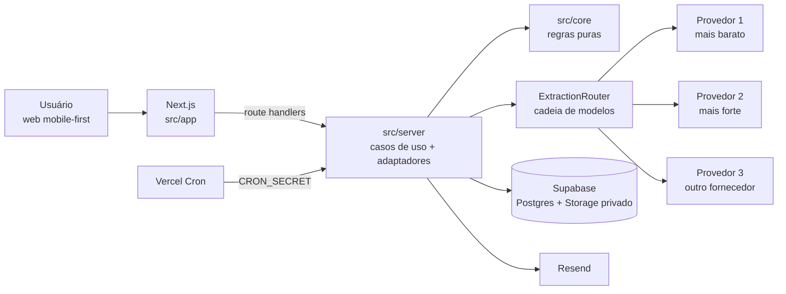
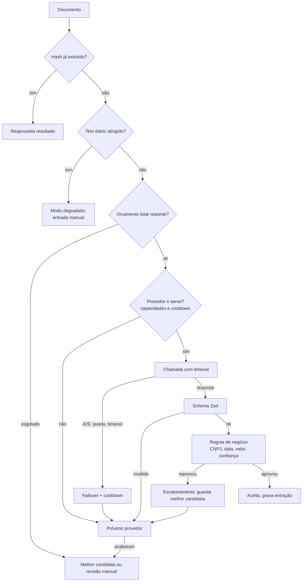
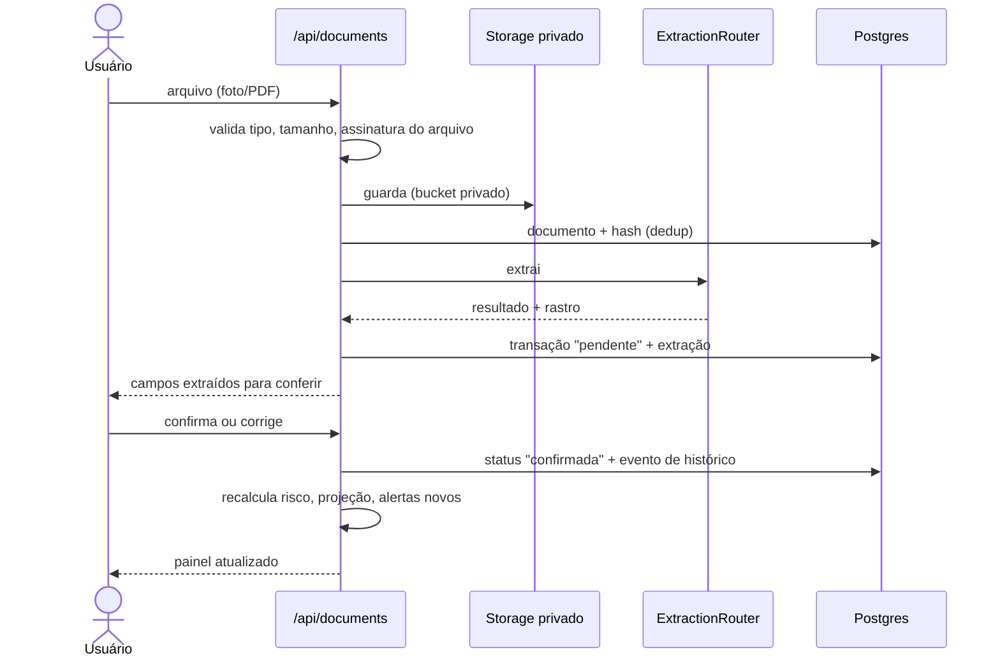

# Arquitetura do Teto

> **Princípio central: a IA propõe, o código dispõe.** O modelo só lê o documento.
> Toda regra de negócio (limites, risco, projeção, alertas, conciliação) é código
> determinístico, tipado e testado. O humano confirma antes de qualquer valor
> afetar o limite.

Documentos relacionados: [modelo de dados](DATA-MODEL.md) ·
[plano de execução](PLANO.md) · [regras do MEI](mei-rules.md) ·
[engenharia de IA](AI-ENGINEERING.md) · [auditoria](AUDITORIA.md)

Legenda de status: ✅ implementado · 🟡 projetado, a implementar · ❓ decisão em aberto.

## 1. Visão geral

O navegador **nunca** fala com o banco nem com os provedores de IA: tudo passa
pelo servidor. Chaves existem só no servidor.

## 2. Camadas e regra de dependência

| Camada | Pasta | Pode depender de | Não pode depender de |
|---|---|---|---|
| Núcleo de domínio | `src/core` | nada (nem Node, nem rede, nem relógio) | qualquer outra camada |
| Servidor | `src/server` | `core` | `app` |
| Interface | `src/app` | `core`, `server` (via rotas) | acesso direto a banco ou IA |

A regra é verificável: o núcleo não importa nada fora de `src/core`. Todo efeito
colateral (banco, rede, relógio, e-mail) entra por **portas** (interfaces) com
implementações trocáveis, o que permite testar o produto inteiro sem rede.

### Portas previstas

| Porta | Implementações | Status |
|---|---|---|
| `VisionProvider` | Gemini, OpenRouter, falsa (testes), gravação e replay (eval) | ✅ |
| `CooldownStore` | memória (testes), Postgres (produção) | ✅ |
| `Clock` | sistema em `America/Sao_Paulo`, fixo (testes) | ✅ |
| `Repositories` (perfil, transações, documentos…) | Supabase, memória (testes) | ✅ perfil, documentos, extrações e storage · 🟡 transações |
| `Notifier` | Resend, falso (testes) | 🟡 |
| `QuotaGuard` | Postgres (contador diário), memória | ✅ |

## 3. Núcleo (`src/core`)

| Módulo | Responsabilidade | Status |
|---|---|---|
| `limits` | Limite anual, proporcional na abertura, receita acumulada | ✅ |
| `risk` | Faixas de risco e estimativa de custo do estouro | ✅ |
| `projection` | Projeção linear e datas de cruzamento do limite e da tolerância | ✅ |
| `scenario` | Simulador "e se eu aceitar uma venda de R$ X?" | ✅ |
| `alerts` | Alertas idempotentes | ✅ |
| `das` | Próximo vencimento do DAS | ✅ |
| `reconcile` | Cruzamento determinístico extrato × notas | ✅ |
| `documents` | CPF, CNPJ, chave de acesso e `deriveDirection` (receita ou despesa, decidido no código) | ✅ |
| `rules` | Configuração **versionada por ano** (`rulesFor`: limite, tolerância, alíquotas) | ✅ |

### Ajustes de fundação (Fase 0, implementados)

1. **Status da transação** no lugar de `confirmed: boolean`:
   `pendente | confirmada | cancelada`. Só `confirmada` entra no acumulado.
   Estorno, devolução e nota cancelada passam a ser `cancelada`, sem valor negativo.
2. **`Clock` em `America/Sao_Paulo`.** O núcleo continua recebendo `today` por
   parâmetro (puro); quem calcula "hoje" é a borda, no fuso de Brasília. Evita o
   erro de o dia virar às 21h locais por causa do UTC.
3. **Regras por ano.** `rulesFor(year)` devolve limite, tolerância e alíquotas
   daquele ano; 2026 é o padrão. A lei muda, o código não.
4. **Data que conta para o limite** isolada em um único campo (`date`) da
   transação. Qual critério alimenta esse campo (emissão ou recebimento) é uma
   decisão de negócio ❓ ver §13; o núcleo não precisa mudar quando ela for tomada.

## 4. Extração com IA (`src/server/extraction`)

Decisões de projeto:

- **Failover** trata falha técnica; **escalonamento** trata falha de qualidade.
- **Orçamento total (`totalBudgetMs`)** além do timeout por chamada, para a cadeia
  nunca estourar o limite de tempo da função serverless. ✅
- **Capacidades por adaptador** (`supportsPdf`, `maxBytes`, `maxPages`): o
  roteador pula quem não consegue processar aquele arquivo. ✅
- **Cooldown persistido** (`CooldownStore` no Postgres): em serverless, memória
  de instância não vale entre requisições. ✅ Se o banco do cooldown ou da cota falhar, o roteador
  segue sem eles (fail-open): uma falha de apoio não derruba a extração.
- **Cache e idempotência por hash** do conteúdo (`processUpload`): o mesmo arquivo nunca é lido
  duas vezes (poupa cota gratuita e sustenta a demo). Upload simultâneo do mesmo arquivo é resolvido
  pela restrição única do banco. ✅
- **Versão do prompt e do schema** gravada em cada extração, para o resultado do
  `eval` apontar para o prompt que o gerou. ✅ (versão do prompt) · 🟡 (gravar no banco)
- **Rastro persistido** (`extractions`): provedor, tentativas, latência, issues, versões do prompt e do schema. ✅
- **Contrato único** (`schema.ts`): dele saem o validador e o JSON Schema
  enviado aos provedores. ✅
- **Direção decidida no código.** A IA devolve as duas partes (`issuerTaxId`: quem vendeu ou
  recebeu; `recipientTaxId`: quem comprou ou pagou). Se o documento é receita ou despesa do MEI
  é decidido por `deriveDirection`, comparando com o CNPJ do perfil. A IA não decide isso. ✅
- **Extração síncrona** com orçamento de tempo. Assíncrona (fila + polling) fica
  como evolução: exige infraestrutura que não cabe no prazo.

### 4.1 Avaliação da extração (eval)

- **Conjunto sintético:** 26 notas geradas por código (`scripts/generate-fixtures.mts`), com gabarito
  em `fixtures/eval/cases.json`: NFS-e, NF-e com chave de acesso, recibos (inclusive letra
  manuscrita), comprovantes Pix com documento mascarado, cupons de despesa, nota borrada e girada,
  e **duas com injeção de prompt**. Dados 100% fictícios. ✅
- **Gravação e replay (VCR):** cada resposta de modelo é gravada por hash do arquivo. A CI e os
  testes repetem as gravações, sem rede, sem chave e sem gastar cota. Mudou o prompt
  (`PROMPT_VERSION`), as gravações antigas deixam de valer. ✅
- **Métricas:** acerto por campo, núcleo correto (data, valor, emissor e destinatário), direção,
  latência p50/p95 e, principalmente, o **erro silencioso** (aceita sem revisão e errada). ✅
- **Relatório gerado:** `npm run eval` escreve [EVAL-RESULTS.md](EVAL-RESULTS.md). ✅
- **Porta de qualidade na CI:** `--min-correct` e `--max-silent-wrong` reprovam a execução se os
  números piorarem. 🟡 (limiares definidos depois dos primeiros resultados)

## 5. Fluxos principais

### Upload → confirmação

### Alertas

1. Após cada confirmação e a cada execução do cron: `newAlerts(...)` calcula o
   que é novo (idempotente).
2. O alerta é **gravado primeiro** (`alerts`, `sent_at = null`) e **enviado depois**.
3. Falha no envio mantém `sent_at = null`; a próxima execução do cron tenta de novo.
4. Alerta enviado não é retirado se o valor cair depois (edição ou cancelamento);
   o painel sempre mostra o estado atual. Isso evita e-mails contraditórios.

### Conciliação

Importa CSV do extrato em `bank_entries`, cruza com `reconcile` (determinístico) e
apresenta "entradas sem nota". O usuário decide se cada uma vira receita
(`origem = pix`), que então segue o fluxo normal de confirmação.

## 6. Segurança e privacidade

| Tema | Decisão |
|---|---|
| Acesso a dados | Só o servidor acessa o banco. RLS **ativada sem políticas para `anon`** (nega tudo por padrão). Chave de serviço só no servidor. |
| Identidade | Demo com **perfil único e público**, aviso na tela: "use apenas dados fictícios". `profile_id` em toda tabela, pronto para Supabase Auth + RLS por usuário (evolução). |
| Upload | Tipos permitidos: JPEG, PNG, WebP, PDF. Limite de tamanho e de páginas. Conferência da **assinatura do arquivo**, não só da extensão. Nome sanitizado. |
| Armazenamento | Bucket **privado**, acesso por URL assinada de curta duração. Limpeza periódica dos arquivos da demo. |
| Entrada de dados | Toda rota valida corpo e parâmetros com Zod. |
| Prompt injection | O documento é **dado, nunca instrução**. Saída restrita a schema e revalidada por código. Casos adversariais entram no `eval`. |
| Segredos | Nenhuma chave com prefixo `NEXT_PUBLIC` além das públicas do Supabase. Varredura com `gitleaks` na CI. |
| Cron | Rota protegida por `CRON_SECRET`. |
| Cabeçalhos | CSP restritiva, `X-Content-Type-Options`, `Referrer-Policy`, `frame-ancestors` via `next.config`. |
| Dependências | `npm audit` (produção) na CI. |
| Logs | Sem dados pessoais nem conteúdo de documentos. Só identificadores, provedor, latência e resultado. |
| Abuso da cota gratuita | **Teto diário global de extrações** (`QuotaGuard`). Ao atingir, o sistema degrada para entrada manual e para as notas de exemplo em cache. |
| Privacidade (LGPD) | Dados sintéticos na demo, aviso explícito, sem coleta além do necessário. |

## 7. Degradação e falhas

| Falha | O que o usuário vê | O que o sistema faz |
|---|---|---|
| Um provedor cai ou dá 429 | Nada (leve atraso) | Failover, cooldown persistido |
| Todos os provedores falham | "Não consegui ler. Preencha manualmente." | Formulário manual pré-aberto, erro registrado |
| Extração com baixa confiança | Campos destacados para conferir | Status `needs_review`, nunca entra sem confirmação |
| Teto diário de extrações | Aviso claro + usar notas de exemplo | `QuotaGuard` bloqueia chamadas à IA |
| Banco indisponível | Mensagem de erro e tentar de novo | Sem estado parcial; operações em transação |
| Falha no envio do e-mail | Alerta aparece no painel | `sent_at` fica nulo; cron tenta de novo |
| Arquivo inválido ou grande demais | Motivo exato | Rejeitado antes de gastar cota de IA |
| Arquivo duplicado | "Esta nota já foi enviada" | Dedup por hash e por chave de acesso |

## 8. Observabilidade

- Log estruturado (uma linha JSON) por requisição, com `requestId`.
- Tabela `extractions` alimenta a tela `/ia`: taxa de sucesso por provedor,
  escalonamentos, latência p50/p95, cota do dia. 🟡
- Rota `/api/health` para checar o deploy antes da gravação do vídeo. 🟡
- Cada `Attempt` aparece também na interface ("lida pelo modelo X em 1,2 s").

## 9. Estratégia de testes

| Nível | O quê | Ferramenta |
|---|---|---|
| Unitário | Regras do `core` ✅ | Vitest |
| Propriedades | Mais receita nunca reduz a faixa; limite proporcional ≤ anual; acumulado independe da ordem | fast-check (se der tempo) |
| Roteador | Failover, cooldown, escalonamento, timeout, orçamento ✅ | Provedores falsos |
| Contrato dos adaptadores | Resposta real gravada → mesmo resultado esperado | Replay de fixtures |
| Integração | Rotas de API com repositórios em memória e provedor falso | Vitest |
| Fluxo completo (fumaça) | upload → extrai → confirma → painel muda | Vitest sobre os handlers |
| Avaliação da IA | Acerto por campo em notas sintéticas, incluindo adversariais | `npm run eval` (replay na CI, limiar de queda) |

## 10. Requisitos não funcionais

| Requisito | Meta |
|---|---|
| Extração de uma nota | p95 abaixo de 15 s; orçamento total de 25 s |
| Painel | Carrega em menos de 2 s com o perfil de demo |
| Responsivo | Usável em 360 px de largura, mobile-first |
| Acessibilidade básica | Rótulos, contraste, navegação por teclado, foco visível |
| Idioma e formatos | pt-BR, `Intl` para moeda e datas |
| Qualidade | `npm run check` verde na `main`; CI obrigatória nos PRs |

## 11. Decisões de arquitetura

| Decisão | Motivo | Alternativa descartada |
|---|---|---|
| Núcleo puro, sem I/O nem relógio | Testável e auditável; é o diferencial do produto | Regras dentro das rotas |
| Dinheiro em centavos inteiros | Sem erro de ponto flutuante | `number` decimal |
| Datas ISO; "hoje" calculado na borda em Brasília | Resultado igual em qualquer máquina, sem virada de dia errada | `Date` local ou UTC implícito |
| Cadeia de 3 modelos gratuitos de 2 fornecedores | Custo zero e sem ponto único de falha | Um provedor pago |
| Só `confirmada` conta no limite | A IA pode errar; o humano valida | Contar tudo que foi extraído |
| `cancelada` em vez de valor negativo | Mantém o histórico e simplifica as regras | Notas de estorno com sinal |
| Custo do estouro como estimativa configurável | A regra tributária exata exige fonte oficial | Valor fixo como oficial |
| Alertas gravados antes de enviados, idempotentes | Resiste a falha de e-mail e a reexecução do cron | Disparo direto sem registro |
| Acesso a dados só pelo servidor, RLS deny-all | Segurança por padrão, mesmo sem login | Cliente falando com o banco |
| Extração síncrona com orçamento de tempo | Cabe no prazo e na função serverless | Fila e processamento assíncrono |
| Teto diário de extrações | Protege a cota gratuita compartilhada | Sem limite |

## 12. Limitações conhecidas (declarar no README)

- Cobre o **MEI comum**; categorias com limite diferente (por exemplo, MEI
  caminhoneiro) estão fora do escopo.
- O custo do estouro é **estimativa**, não cálculo oficial; o Teto não substitui
  um contador.
- Perfil único de demonstração, sem login. Autenticação por usuário é a evolução.
- Extração síncrona; notas em lote muito grandes não são o foco.
- A projeção é linear e não considera sazonalidade.

## 13. Decisões em aberto

| Questão | Como resolver | Responsável / prazo |
|---|---|---|
| Qual data conta para o limite: emissão ou recebimento? | Consultar a fonte oficial e registrar em `mei-rules.md` | Terça 24/11 |
| Valores atuais do limite, tolerância e DAS | Confirmar no Portal do Empreendedor | Terça 24/11 |
| Alíquotas reais para estimar o custo do estouro | Confirmar ou manter placeholder rotulado como estimativa | Terça 24/11 |
| Modelos e limites exatos dos tiers gratuitos | Conferir no AI Studio e no OpenRouter, preencher `MODEL_CHAIN` | Hoje |
