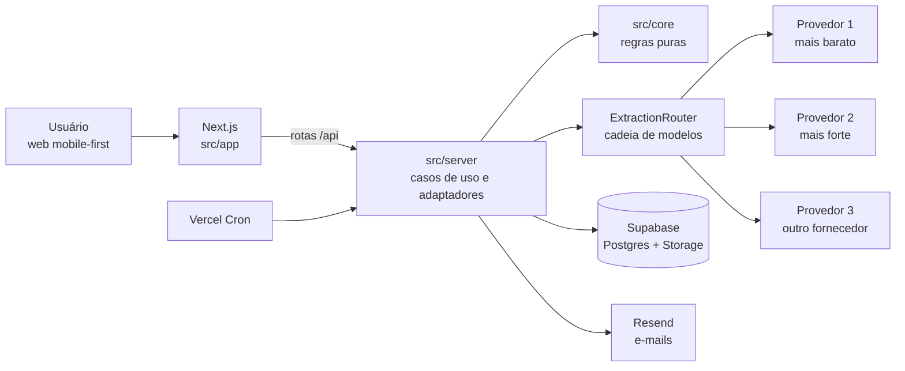
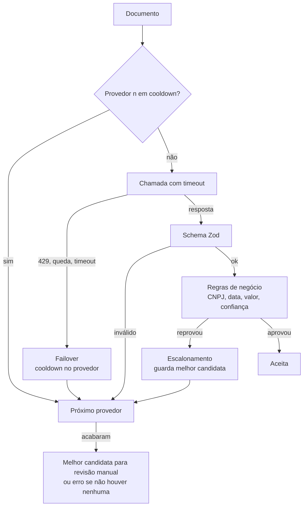

# Arquitetura do Teto

O princípio central é: **a IA propõe, o código dispõe**. O modelo só lê o documento.
Toda regra de negócio (limites, risco, projeção, alertas, conciliação) é código
determinístico, tipado e testado.

## Camadas e regra de dependência

| Camada | Pasta | Pode depender de | Não pode depender de |
|---|---|---|---|
| Núcleo de domínio | `src/core` | nada (nem Node, nem rede) | qualquer outra camada |
| Servidor | `src/server` | `core` | `app` |
| Interface | `src/app` | `core`, `server` | – |

A regra "o núcleo não conhece I/O" é o que permite testar o produto inteiro sem
banco, sem rede e sem chave de API.

## Núcleo (`src/core`)

| Módulo | Responsabilidade |
|---|---|
| `limits` | Limite anual, limite proporcional na abertura, receita acumulada |
| `risk` | Faixas de risco e estimativa de custo do estouro |
| `projection` | Projeção linear do ano e datas de cruzamento do limite e da tolerância |
| `scenario` | Simulador "e se eu aceitar uma venda de R$ X?" |
| `alerts` | Alertas idempotentes (não repetem o que já foi enviado) |
| `das` | Próximo vencimento do DAS |
| `reconcile` | Cruzamento determinístico extrato × notas |
| `documents` | Validação de CPF, CNPJ e chave de acesso |

## Extração com IA (`src/server/extraction`)

- **Failover** trata falha técnica; **escalonamento** trata falha de qualidade.
- Cada tentativa gera um registro (`Attempt`) com provedor, resultado e latência.
- O contrato do que o modelo devolve vive num único lugar (`schema.ts`), de onde
  saem o validador e o JSON Schema enviado aos provedores.
- O documento é tratado como **dado não confiável**: a saída é restrita ao
  schema e revalidada por código.

## Decisões

| Decisão | Motivo | Alternativa descartada |
|---|---|---|
| Núcleo puro, sem I/O | Testável e auditável; o diferencial do produto é código próprio | Regras dentro das rotas da API |
| Dinheiro em centavos inteiros | Evita erro de arredondamento de ponto flutuante | `number` com casas decimais |
| Datas ISO em UTC | Resultado igual em qualquer máquina ou fuso | `Date` local |
| Cadeia de 3 modelos gratuitos de 2 fornecedores | Sem custo e sem ponto único de falha | Um único provedor pago |
| Só receitas confirmadas contam | A IA pode errar; o humano confirma antes de afetar o limite | Contar tudo que foi extraído |
| Custo do estouro como estimativa configurável | A regra tributária exata precisa de fonte oficial | Valor fixo apresentado como oficial |
| Alertas idempotentes | O job pode rodar várias vezes sem duplicar e-mails | Controle por data da última execução |

## Pendências conhecidas

- Adaptadores reais dos provedores (Gemini, OpenRouter) e leitura de `MODEL_CHAIN`.
- Persistência (Supabase) e rotas `/api`.
- Interface: upload, confirmação, painel, simulador.
- Alertas por e-mail (Resend) e cron.
- Harness de avaliação (ver `docs/AI-ENGINEERING.md`).
