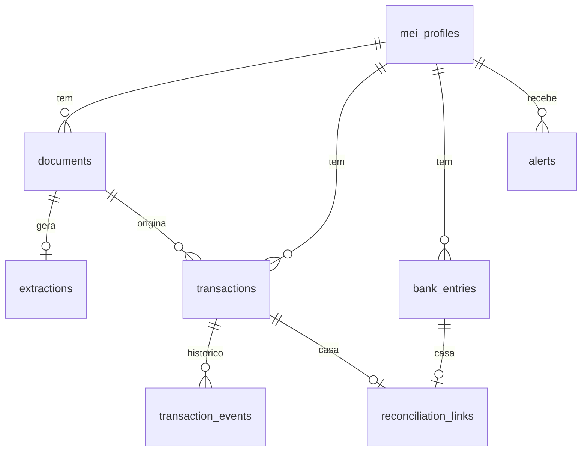

# Modelo de dados

Schema do Supabase (Postgres), implementado em `supabase/migrations/`:
`0001_init.sql` (tabelas, restrições e RLS) e `0002_one_transaction_per_document.sql`
(um documento vira no máximo um lançamento).

Convenções:
- Chave primária `uuid` (`gen_random_uuid()`).
- Dinheiro em **centavos** (`bigint`), nunca `numeric` decimal nem `float`.
- Datas de negócio em `date`; instantes em `timestamptz`.
- `profile_id` em toda tabela de dados, para isolamento futuro por usuário.
- Todas as tabelas com **RLS ativada e sem políticas para `anon`** (nega tudo).
  O servidor usa a chave de serviço.

## Diagrama

## Tabelas

### `mei_profiles`
| Coluna | Tipo | Observação |
|---|---|---|
| id | uuid PK | |
| name | text | nome fictício na demo |
| tax_id | text | CNPJ validado pelo `core`; único |
| opening_date | date | define o limite proporcional |
| email | text | destino dos alertas |
| created_at | timestamptz | |

### `documents`
| Coluna | Tipo | Observação |
|---|---|---|
| id | uuid PK | |
| profile_id | uuid FK | |
| storage_path | text | bucket privado |
| content_hash | text | SHA-256 do arquivo |
| mime_type | text | validado pela assinatura do arquivo |
| size_bytes | integer | |
| kind | text | `nota` · `recibo` · `extrato` |
| created_at | timestamptz | |

Restrição: **único `(profile_id, content_hash)`** → idempotência de upload.

### `extractions`
Rastro do que a IA fez, uma linha por documento extraído.

| Coluna | Tipo | Observação |
|---|---|---|
| id | uuid PK | |
| document_id | uuid FK único | |
| status | text | `accepted` · `needs_review` · `failed` |
| provider_id | text | quem produziu o resultado final |
| prompt_version | text | liga o resultado ao prompt do eval |
| schema_version | text | |
| attempts | jsonb | lista de `Attempt` (provedor, resultado, latência, issues) |
| raw_result | jsonb | saída validada do modelo (emissor e destinatário; o modelo não devolve `kind`) |
| created_at | timestamptz | |

### `transactions`
| Coluna | Tipo | Observação |
|---|---|---|
| id | uuid PK | |
| profile_id | uuid FK | |
| document_id | uuid FK nulo | nulo em lançamento manual |
| date | date | **data que conta para o limite** (critério a confirmar) |
| issue_date | date nulo | data de emissão da nota, se houver |
| amount_cents | bigint | CHECK `> 0` |
| kind | text | `receita` · `despesa`; derivada por `deriveDirection` a partir do CNPJ do perfil, e o usuário pode corrigir |
| source | text | `nota` · `pix` · `manual` |
| status | text | `pendente` · `confirmada` · `cancelada` |
| counterparty_tax_id | text nulo | a outra parte, depois de derivada a direção |
| access_key | text nulo | 44 dígitos |
| description | text | |
| confidence | real nulo | 0 a 1 |
| created_at / updated_at | timestamptz | |

Restrições e índices:
- Único parcial `(profile_id, access_key)` quando `access_key` não é nulo.
- Único parcial `(profile_id, document_id)` quando `document_id` não é nulo (migração `0002`): dois toques
  simultâneos em "Confirmar" não criam dois lançamentos do mesmo documento.
- Índice `(profile_id, date)` para o acumulado e a projeção.
- `CHECK (amount_cents > 0)`: estorno vira `status = 'cancelada'`.

### `transaction_events`
Histórico imutável de alterações (confirmar, corrigir, cancelar).

| Coluna | Tipo |
|---|---|
| id | uuid PK |
| transaction_id | uuid FK |
| action | text (`created` · `corrected` · `confirmed` · `cancelled`) |
| changes | jsonb (campo → antes/depois) |
| created_at | timestamptz |

### `bank_entries`
> **Reservada, ainda sem uso.** A importação do extrato roda inteira no navegador (o CSV é lido e conciliado
> na tela e não é gravado), então `bank_entries` e `reconciliation_links` existem no schema, mas o app não
> escreve nelas. Persistir o extrato é uma evolução possível.

| Coluna | Tipo | Observação |
|---|---|---|
| id | uuid PK | |
| profile_id | uuid FK | |
| date | date | |
| amount_cents | bigint | crédito |
| description | text | |
| import_batch | uuid | agrupa um CSV |

Único `(profile_id, date, amount_cents, description, import_batch)`.

### `reconciliation_links`
`bank_entry_id` (único), `transaction_id` (único), `day_diff`, `created_at`.
Garante o pareamento um-para-um.

### `alerts`
| Coluna | Tipo | Observação |
|---|---|---|
| id | uuid PK | |
| profile_id | uuid FK | |
| kind | text | `threshold_warning` (80%) · `threshold_critical` (90%) · `over_limit` (100%) · `over_tolerance` (120%) · `das_reminder` (reservado: o lembrete do DAS não está implementado, porque aqui só cabe uma data por ano) |
| reference_year | integer | |
| created_at | timestamptz | quando foi gerado |
| sent_at | timestamptz nulo | nulo = ainda não enviado (cron tenta de novo). A reserva é atômica (`update … where sent_at is null returning`): cron e confirmação não enviam o mesmo alerta duas vezes |

Único `(profile_id, kind, reference_year)` → idempotência dos alertas.

### `provider_cooldowns`
| Coluna | Tipo |
|---|---|
| provider_id | text PK |
| blocked_until | timestamptz |
| reason | text |

### `daily_quota`
| Coluna | Tipo | Observação |
|---|---|---|
| day | date PK | dia em Brasília |
| extractions | integer | contador do teto diário |

## Storage

- Bucket `documents`, **privado**. Limite do app: 4 MB por arquivo (a Vercel corta em 4,5 MB).
- Caminho: `{profile_id}/{content_hash}.{ext}`.
- Acesso só por URL assinada de curta duração.
- Rotina de limpeza dos arquivos da demo.

## Regras de consistência

1. Só `status = 'confirmada'` e `kind = 'receita'` entram no acumulado.
2. Toda mudança de `status` ou de valor gera um `transaction_event`.
3. Confirmação e gravação do evento ocorrem **na mesma transação** do banco.
4. Alerta enviado não é retirado quando o valor cai; o painel mostra o estado atual.
5. Nenhum dado pessoal real: tudo sintético.
6. Um documento vira no máximo um lançamento (índice único da `0002`).
7. CPF e CNPJ da outra parte e a chave de acesso saem **mascarados** do servidor para a tela; o dado inteiro fica só no banco.
